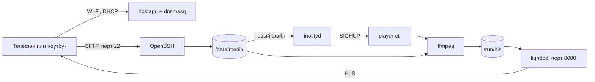
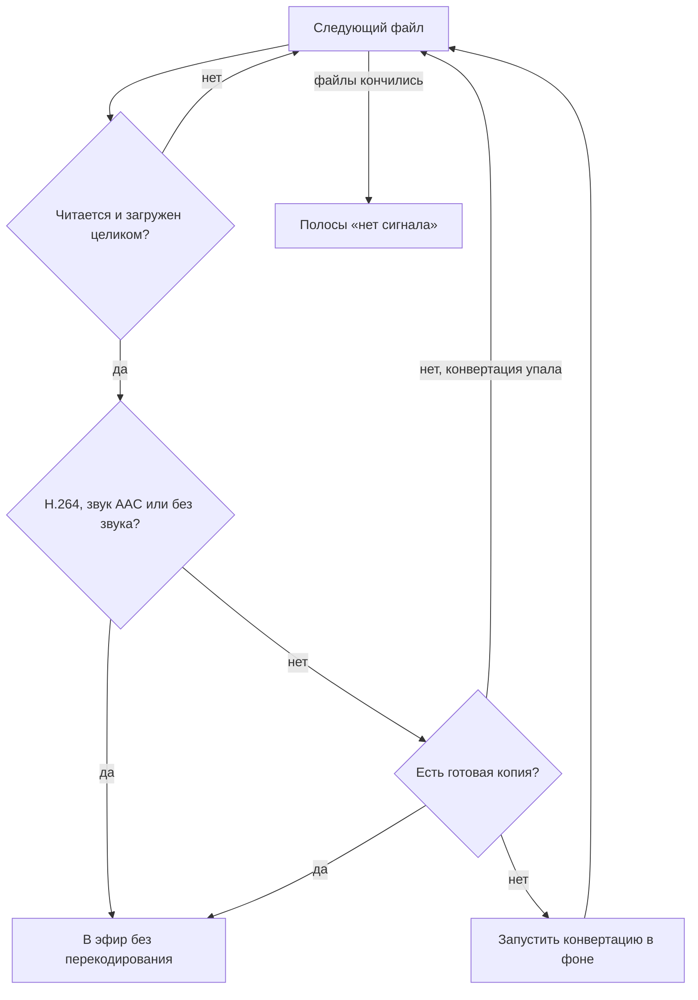

# Устройство

## Общая схема

| Часть | Чем сделана |
|---|---|
| Система | Buildroot 2026.02.3, ядро Raspberry Pi 6.12, BusyBox init, glibc |
| Точка доступа | `hostapd` на `wlan0` с драйвером `brcmfmac` |
| DHCP и имя `cam.lan` | `dnsmasq` |
| SSH и SFTP | OpenSSH, встроенный `internal-sftp` |
| Поток | `ffmpeg`, сегменты в оперативной памяти |
| Веб-сервер | `lighttpd` |
| Логика плеера | скрипт [`player-ctl`](../br2-external/board/common/rootfs-overlay/usr/sbin/player-ctl) |

## Разделы карты

| Раздел | Формат | Размер | Содержимое |
|---|---|---|---|
| `BOOT` | FAT32 | 64 МБ | Загрузчик Pi, ядро, DTB, `config.txt`, `cmdline.txt`, `rpi-player.conf` |
| `rootfs` | ext4 | 200 МБ | Система |
| `data` | ext4 | 200 МБ | `/data/media` с видео, `/data/ssh` с ключами |

Содержимое `/run`, включая сегменты потока, находится в оперативной памяти, поэтому поток
не изнашивает карту.

## Порядок загрузки

Скрипты лежат в [`/etc/init.d`](../br2-external/board/common/rootfs-overlay/etc/init.d):

| Скрипт | Что делает |
|---|---|
| `S01storage` | Находит разделы на карте или USB-флешке, монтирует `BOOT` и `data`, объединяет настройки в `/run/rpi-player.env`, задаёт пароли |
| `S20modules` | Загружает модули из `/etc/modules`, на Pi это драйвер Wi-Fi `brcmfmac` |
| `S41eth0` | Запускает DHCP-клиент на Ethernet в фоне, загрузка его не ждёт |
| `S42wifi-ap` | Применяет страну, назначает адрес `wlan0`, запускает `hostapd` |
| `S43dnsmasq` | Запускает DHCP и DNS для клиентов Wi-Fi |
| `S44sshd` | Создаёт ключи сервера при первом запуске, запускает `sshd` |
| `S60httpd` | Запускает `lighttpd` |
| `S70player` | Запускает `player-ctl` и слежение за папкой с видео |

## Как выбирается видео

При старте и при каждом изменении в `/data/media` скрипт `player-ctl` просматривает файлы:
сначала закреплённый (`MEDIA_FILE` или ссылка `current`), затем остальные от новых к старым.

Особенности:

- Если выбранное видео не изменилось, поток не перезапускается. Поэтому неудачная заливка
  другого файла не прерывает эфир.
- Перекодированная копия хранится в `/data/media/.cache`. Там остаётся только самая новая
  копия. Исходные файлы никогда не удаляются автоматически.
- При конвертации видео сначала пробуется аппаратный кодер `h264_v4l2m2m`, затем `libx264`.
  Если видео уже в H.264, оно копируется и перекодируется только звук.
- Целостность определяется по сообщению ffmpeg `partial file`, его выдаёт разбор MP4 и
  родственных форматов. Обрыв MKV или TS так не обнаруживается, и такой файл может попасть в эфир.

## Параметры потока

Плейлист живой: без `#EXT-X-ENDLIST`, старые сегменты удаляются, номера начинаются от текущего
времени и поэтому растут и после перезапуска. Смена источника помечается `#EXT-X-DISCONTINUITY`.

## Безопасность

Устройство рассчитано на работу в своей изолированной сети:

- вход по паролю для `root` включён;
- поток отдаётся по HTTP без шифрования и авторизации;
- через SFTP под `root` доступна вся файловая система;
- `media` тоже не ограничен своей папкой.

Перед реальным использованием [смени пароли](configuration.md#пароли) и по возможности
перейди на вход по ключу.
